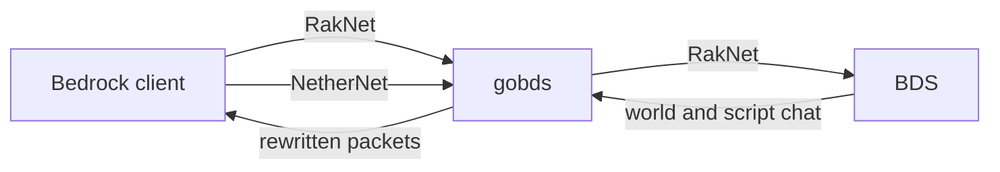
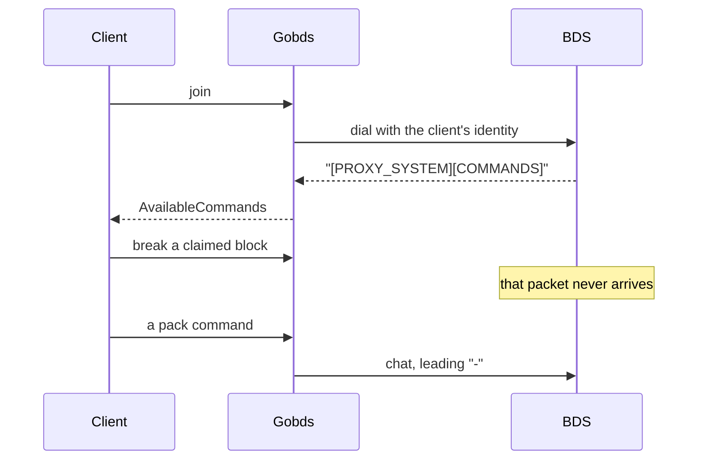

# gobds

A proxy in front of Minecraft Bedrock Dedicated Server. Players connect to
gobds. gobds connects to BDS. Packets that should never reach the server are
dropped here, before the Script API has to notice them.

Built on [gophertunnel](https://github.com/Sandertv/gophertunnel). One process
can front several worlds. Built for PokeBedrock, and the config is just a list
of listen addresses and backends.



The public port is gobds. BDS stays on loopback, or wherever `RemoteAddress`
points. The server-list pong is the proxy's own session count and the capacity
in config, so a backend with LAN visibility off still shows the right numbers.

## Why the packets stop here

The Script API runs after BDS has accepted an action, and some client actions
never become a script event at all. gobds is on the wire.

A denied claim action is removed from the packet. A break or place outside the
world border is removed too. Chunks outside that border are not forwarded. A
hold-to-interact that repeats every tick is dropped, so the script engine does
not pay for it. A melee swing at a painting, armor stand, or cushion inside a
claim is stripped from the movement packet on 1.26.60, where that swing carries
no entity id and the script `entityHurt` path never runs. The movement packet
itself still goes through.

Claim data comes from an HTTP endpoint and is stored as an immutable snapshot.
A snapshot older than `MaxSnapshotAge` fails open and the action is passed to
BDS. A panic in the claim path fails open the same way. Pickup cannot be
enforced here: Bedrock resolves item pickup on the server, and the client only
hears about it afterwards.

Chat, commands, forms, and inventory have size caps. With
`[TrafficProtection] Enforce = true`, rate excess is dropped. The default is
observe and count.

## What a session does

1. The client joins the public listener. RakNet is always on. NetherNet
   (WebRTC, Bedrock 26.50 and later) is optional and sits beside it: signaling
   on the game port's TCP, ICE on `UDPPort`. Clients that fail ICE do not fall
   back inside this proxy. RakNet is a second listener, not a retry of the
   same join.
2. Optional gates run before BDS is dialed: a VPN check, a hub authentication
   service ("join through the hub"), the whitelist, reserved slots for
   whitelisted names, and a duplicate-XUID reject.
3. gobds dials BDS with that client's identity. Upstream transport defaults to
   RakNet. `Transport = "nethernet"` dials BDS over NetherNet instead, and
   `RemoteAddress` is then the BDS signaling address.
4. Handled packets pass through a handler. Cancel means the other side never
   sees that packet. Everything else is forwarded.
5. The behavior pack publishes its command catalog as chat, prefixed
   `[PROXY_SYSTEM][COMMANDS]=`. A catalog bigger than one Text packet is split
   into `[PROXY_SYSTEM][COMMANDS:i/n]=` chunks. gobds reassembles them, merges
   them into `AvailableCommands`, and drops the vanilla entry when a pack
   command uses the same name. Otherwise BDS runs vanilla.
6. A pack command the client runs is forwarded to BDS as chat with a leading
   `-`, and the original command packet is cancelled. Vanilla commands the
   pack does not shadow pass through. `me`, `tell`, `w`, and `msg` are
   dropped.
7. Disconnect removes the session. The advertised player count is the live set
   across every listener on that server, RakNet and NetherNet together.



## Also on the session

| | |
| --- | --- |
| Resource packs | Served by the proxy from `[[Resources.Packs]]`. Clients do not receive BDS world packs. Each offer can require a minimum memory tier and a language. Filters are AND-ed. Tier `0` and an empty language match everyone. Index 0 is the highest priority. |
| Item runtime IDs | Written to `item-registry-<server>.json` from the registry BDS sent. Add-on item IDs follow the host's directory order, so each machine's map is its own. |
| XUID | BDS sees the proxy's connection. The player's XUID is delivered as encrypted chat, prefixed `[PROXY_XUID]`, using `[Encryption] Key`. |
| Latency | Forwarded to BDS as `[PROXY_PING] <ms>` when it changes. |
| Name tags | `pokemon:` entities get a per-client translation of the name the server sent, which one name tag cannot do. Nicknames marked with the nick prefix are left alone. See [docs/name_tags.md](docs/name_tags.md). |
| AFK | Idle players are warned on a timer. Once the server is at or above `FullnessThreshold` (default 0.9), the longest-idle sessions are kicked first. |
| Claims, visually | With `DenyRenderingEnabled`, protected ground is drawn as deny blocks in the subchunks the client loads. |

Command registration, aliases, and the chunk format are in
[docs/Commands.md](docs/Commands.md). Claim payload shape is in
[docs/Claims.md](docs/Claims.md).

## Run

`config.toml` is gitignored. Start from the example:

```bash
cp config.example.toml config.toml
go run .
```

Point each server's `LocalAddress` at the port players use, and `RemoteAddress`
at BDS.

```toml
[[Network.Servers]]
Name = 'survival'
LocalAddress = '0.0.0.0:19132'
RemoteAddress = '127.0.0.1:19133'
Transport = 'raknet'
MOTD = 'survival'
MaxPlayers = 85

[Network.Servers.NetherNet]
Enabled = false
UDPPort = 19133
```

NetherNet needs TCP open on the game port and UDP open on `UDPPort`.
`TurnAddress` / `TurnSecret` add a coturn relay for clients behind symmetric
NAT. Empty means no TURN. `PublicIP` is an optional host ICE candidate.

A resource pack:

```toml
[[Resources.Packs]]
URL = 'https://example.com/pack.mcpack'
MinMemoryTier = 0
Language = ''
```

`URLResources` and `PathResources` still load, unfiltered, after `Packs`.

Claims, when you want them, are one HTTP endpoint per server:

```toml
[Network.Servers.ClaimService]
Enabled = true
URL = 'http://127.0.0.1:3001/api/database/world/table/claims'
Key = 'secret-key'

[Claims]
PrefilterEnabled = true
DenyRenderingEnabled = false
PollInterval = '15s'
MaxSnapshotAge = '45s'
```

The `Key` is sent as the raw `Authorization` header, no `Bearer` prefix.
Keep it in `config.toml`, not in git.
